# ⚡ Awesome Cloud Object Storage Connectors 🌐

  
  
  
  
  
  

  <strong>🚀 A battle-tested curated directory of SaaS object storage services, enterprise multi-cloud connectors, S3-compatible gateways, FUSE drivers, and file transfer engines.</strong>

---

## 📖 Overview

Cloud Object Storage Connectors bridge applications, legacy POSIX file systems, distributed compute clusters, and multi-cloud architectures with scalable object storage backends (**AWS S3**, **Google Cloud Storage**, **Azure Blob**, **Cloudflare R2**, **MinIO**, **Ceph**, and **Backblaze B2**). This guide compiles industry-leading SaaS platforms and battle-tested open-source projects designed to eliminate vendor egress lock-in, enable unified multi-cloud data access, mount buckets locally via FUSE, and orchestrate petabyte-scale file transfers.

---

## 📑 Table of Contents

- [📊 Sector Overview & Market Dynamics](#-sector-overview--market-dynamics)
- [☁️ SaaS & Hosted Cloud Storage Platforms](#️-saas--hosted-cloud-storage-platforms)
- [💻 Open-Source GitHub Projects](#-open-source-github-projects)
- [🏗️ Architecture & Use Case Patterns](#️-architecture--use-case-patterns)
- [🤝 How to Contribute](#-how-to-contribute)
- [⭐ Star History](#-star-history)
- [💖 Support & Community](#-support--community)
- [⚠️ Disclaimer](#️-disclaimer)

---

## 📊 Sector Overview & Market Dynamics

The global cloud object storage and storage gateway market is estimated at **$8.6B – $9.8B in 2025–2026** and is projected to expand past **$25B – $28B by the mid-2030s**, compounding at a **11% – 13.5% CAGR** fueled by generative AI training data lakes, unstructured media growth, and multi-cloud redundancy demands.

From a structural perspective, the infrastructure tier remains **moderately concentrated among hyperscalers** (AWS S3, Microsoft Azure Blob, and Google Cloud Storage), which hold the largest enterprise market shares. However, the connectivity, gateway, and challenger tier is **rapidly fragmenting and democratizing** due to universal standardization on the **Amazon S3 API**. Challenger storage providers (Wasabi, Cloudflare R2, Backblaze B2) compete aggressively by eliminating or discounting egress penalties, while high-performance open-source tools (MinIO, Rclone, JuiceFS, SeaweedFS) allow organizations to run vendor-neutral, zero-lock-in storage pipelines across on-premises clusters and edge clouds.

---

## ☁️ SaaS & Hosted Cloud Storage Platforms

The following table compares leading commercial object storage providers and managed cloud storage connector services. Entries are sorted in descending order by parent company scale (market capitalization or estimated enterprise valuation).

| 🏢 Product | 📈 Company Scale (Valuation / Revenue) | 📝 Description | 🏷️ Pricing (Starting Tier) | 🎁 Free Tier / Trial Limits |
|:---|:---|:---|:---|:---|
| **[Microsoft Azure Blob Storage](https://azure.microsoft.com/en-us/products/storage/blobs/)** | **~$3.1T Market Cap** (Microsoft) | Hyperscale object storage featuring Hot, Cool, Cold, and Archive storage tiers. Supports extensive enterprise security, NFS v3.0, and data lake storage (ADLS Gen2). | **$0.018 / GB-month** (Hot LRS tier, East US); Cool: $0.010 / GB-month; Cold: $0.0045 / GB-month; Archive: $0.00099 / GB-month | **30-Day Free Trial**: $200 free Azure credits for first 30 days, plus 5 GB LRS Hot block blob storage free for 12 months |
| **[AWS S3](https://aws.amazon.com/s3/)** | **~$2.2T Market Cap** (Amazon / AWS) | The reference global cloud object storage standard with the largest connector and developer tooling ecosystem. Offers 99.999999999% (11 9s) durability across multi-tier lifecycle tiers. | **$0.023 / GB-month** (S3 Standard first 50 TB); Glacier Instant Retrieval: $0.004 / GB-month; Glacier Deep Archive: $0.00099 / GB-month | **12-Month Free Tier**: 5 GB S3 Standard storage, 20,000 GET requests, and 2,000 PUT/POST/LIST requests/month for 12 months |
| **[Google Cloud Storage](https://cloud.google.com/storage)** | **~$2.1T Market Cap** (Alphabet / Google) | Unified object storage offering Standard, Nearline, Coldline, and Archive tiers with global single-namespace access and native XML S3-compatibility API endpoints. | **$0.020 / GB-month** (Standard regional); Nearline: $0.010 / GB-month; Coldline: $0.004 / GB-month; Archive: $0.0012 / GB-month | **90-Day Free Trial**: $300 free billing credits valid for 90 days across Google Cloud services (no permanent free storage quota) |
| **[Cloudflare R2](https://www.cloudflare.com/developer-platform/r2/)** | **~$98B – $104B Market Cap** (NYSE: NET) | High-performance, zero-egress fee S3-compatible distributed object storage natively integrated with Cloudflare Workers edge compute network. | **$0.015 / GB-month** (Standard); Infrequent Access: **$0.010 / GB-month**; $0 data egress bandwidth charges | **Permanent Free Tier**: 10 GB-month active storage, 1,000,000 Class A operations/month, and 10,000,000 Class B operations/month free forever |
| **[Zoho Catalyst Stratus](https://www.zoho.com/catalyst/)** | **~$12B – $12.5B Est. Valuation** (~$1.5B ARR) | Developer cloud object storage within the Zoho Catalyst ecosystem featuring full S3 compatibility, flat namespace, and zero data egress bandwidth charges. | **$0.020 / GB-month** flat storage rate; $0 data egress bandwidth transfer charges | **Permanent Free Tier**: 5 GB file storage per month with zero egress charges included on Catalyst free developer quota |
| **[Wasabi](https://wasabi.com/)** | **~$1.8B Valuation** (~$120M+ ARR) | Dedicated hot cloud object storage offering predictable single-tier pricing with zero fees for egress bandwidth or API PUT/GET requests. | **$6.99 / TB-month** ($0.0068 / GB-month); 1 TB monthly minimum active storage allocation | **30-Day Free Trial**: 100 GB fully featured storage for 30 days (corporate domain) or 10 GB for 14 days (public domain) |
| **[Backblaze B2](https://www.backblaze.com/)** | **~$500M – $530M Market Cap** (NASDAQ: BLZE) | High-durability, developer-friendly S3-compatible cloud storage widely utilized for ransomware protection, media streaming, and multi-cloud backups. | **$6.00 / TB-month** ($0.006 / GB-month); free egress up to 3x average monthly data stored | **Permanent Free Tier**: 10 GB storage free forever, free uploads, free downloads up to 1 GB/day, and unlimited free partner CDN egress |
| **[ExpanDrive](https://www.expandrive.com/)** | **Acquired by Files.com** (Private / Bootstrapped) | Fast desktop storage gateway and virtual drive mounter that connects Windows, macOS, and Linux systems directly to S3, GCS, Azure, and Backblaze without downloading entire datasets. | **$29.00 / month** (Starting business tier for teams exceeding 10 seats); Server Edition quotes available | **Permanent Free Tier**: 100% free forever for personal use, individual developers, and small teams up to 10 users/devices with all features |
| **[CloudBerry by MSP360](https://www.msp360.com/)** | **~$20M ARR** (Private / Bootstrapped) | Managed backup agent, cloud explorer, and storage gateway connector supporting direct integration with AWS S3, Wasabi, Backblaze B2, and Azure Blob. | **$29.99 / year** (Desktop Pro Edition license); CloudBerry Drive starts at **$49.99** one-time perpetual license | **15-Day Free Trial**: 15-day fully featured trial with unlimited bandwidth; MSP360 Backup Community Edition is free for personal use under 5 TB storage |

---

## 💻 Open-Source GitHub Projects

The following table lists top open-source object storage servers, cloud filesystem gateways, and multi-cloud transfer connectors. Repositories are sorted in descending order by GitHub Stars_Count. Each Stars_Badge links directly to that repository's stargazers page.

| 📦 Project | ⭐ GitHub_Stars | 📝 Description | 🎯 Primary Use Case |
|:---|:---:|:---|:---|
| **[MinIO](https://github.com/minio/minio)** |  | High-performance, Kubernetes-native, S3-compatible object storage suite written in Go. Distributed, software-defined, and enterprise-ready. | On-premises S3 server & Private Cloud Data Lake |
| **[Rclone](https://github.com/rclone/rclone)** |  | "The Swiss army knife of cloud storage" — syncs, transfers, encrypts, and mounts directories across 70+ cloud providers including S3, B2, GCS, and Azure. | CLI synchronization, cloud-to-cloud migration, and FUSE mounting |
| **[Restic](https://github.com/restic/restic)** |  | Fast, secure, deduplicating backup program written in Go that natively writes to Amazon S3, MinIO, Azure Blob, and Backblaze B2 targets. | Deduplicated, encrypted snapshot backups to object storage |
| **[SeaweedFS](https://github.com/seaweedfs/seaweedfs)** |  | Highly scalable distributed file system and S3-compatible object store optimized for billions of small files and low-latency throughput. | High-throughput distributed blob storage with S3 and POSIX API |
| **[Ceph](https://github.com/ceph/ceph)** |  | Massively scalable, enterprise-grade unified distributed storage architecture offering Ceph RADOS Gateway (RGW) for S3 and Swift object endpoints. | Petabyte/Exabyte datacenter unified block, file, and object storage |
| **[JuiceFS](https://github.com/juicedata/juicefs)** |  | High-performance POSIX-compatible shared file system built on top of Redis/relational databases for metadata and S3/cloud object storage for data blocks. | Big data, AI/ML distributed model training, and Kubernetes PV storage |
| **[s3fs-fuse](https://github.com/s3fs-fuse/s3fs-fuse)** |  | FUSE (Filesystem in Userspace) interface that allows Linux, macOS, and container environments to mount S3 buckets as standard local file directories. | Transparent file-system mounting for legacy applications |
| **[Goofys](https://github.com/kahing/goofys)** |  | High-performance FUSE file system written in Go for Amazon S3 and Microsoft Azure Blob, prioritizing throughput and low time-to-first-byte over strict POSIX compliance. | Read-heavy and high-throughput bucket mounting without local caching lag |
| **[s3cmd](https://github.com/s3tools/s3cmd)** |  | Pioneer command-line client and automation tool for uploading, retrieving, and managing data in Amazon S3 and S3-compatible cloud storage providers. | Scripted S3 batch file transfers and bucket lifecycle policies |
| **[Cyberduck](https://github.com/iterate-ch/cyberduck)** |  | Open-source GUI multi-cloud file browser for macOS and Windows with native support for S3, Backblaze B2, Google Cloud Storage, Azure Blob, SFTP, and WebDAV. | Desktop graphical multi-cloud exploration and ad-hoc file transfers |
| **[s5cmd](https://github.com/peak/s5cmd)** |  | Ultra-fast, massively parallel command-line S3 client built in Go, utilizing worker pools to maximize network throughput on bulk upload/download tasks. | High-speed multi-threaded batch data transfer & pipeline ingestion |
| **[VersityGW](https://github.com/versity/versitygw)** |  | Modular, high-performance S3 storage gateway that translates S3 API calls to diverse backend filesystems (POSIX, NFS, Ceph, and tape archives). | S3 API gateway translation layer for existing enterprise file servers |
| **[Apache Libcloud](https://github.com/apache/libcloud)** |  | Standard Python multi-cloud abstraction library delivering a single unified programmatic API across 30+ cloud object storage providers. | Programmatic multi-cloud SDK abstraction for Python backends |

---

## 🏗️ Architecture & Use Case Patterns

Building a resilient, cost-effective object storage pipeline typically combines layered tools:

1. 🧱 **Storage Tiering & Persistence**:
   - Private / On-Prem: **MinIO** or **Ceph RGW** on bare metal or NVMe SANs.
   - Public Cloud Hot Tier: **Wasabi**, **Backblaze B2**, or **Cloudflare R2** for zero/low egress.
   - Cold / Compliance Archive: **AWS S3 Glacier Deep Archive** or **Azure Archive Blob**.
2. 🔌 **Connectivity & Filesystem Adapters**:
   - Use **s3fs-fuse** or **Goofys** to mount remote object storage as local file paths for applications without native S3 SDK code.
   - Use **JuiceFS** when POSIX metadata consistency and distributed cache speed are required for AI/ML workloads.
3. 🔄 **Data Ingestion & Cross-Cloud Replication**:
   - Use **Rclone** for cron-based sync and migration between cloud providers without intermediary local storage.
   - Use **s5cmd** inside data ingestion pipelines to saturate high-bandwidth 25GbE/100GbE network interfaces.
4. 🖥️ **Desktop & User Access**:
   - Use **Cyberduck** or **ExpanDrive** for team members needing direct drag-and-drop bucket access without CLI configurations.

---

## 🤝 How to Contribute

We welcome additions, updates, and corrections from the community:

1. 🍴 Fork this repository.
2. 🌿 Create a new branch: `git checkout -b feature/new-connector`.
3. 📝 Add your entry following the established table structure, ensuring:
   - Pricing includes precise starting rates (no generic "Custom" or "Usage-based" text).
   - Free tiers and trials specify exact durations and limits.
   - Stars_Badges follow the `style=social&color=white` badge format and link to stargazers.
4. 🚀 Submit a Pull Request with a clear description of the project and why it belongs here.

---

## ⭐ Star History

---

## 💖 Support & Community

Thank you so much for exploring and supporting **Awesome Cloud Object Storage Connectors**! 🌟

If you find this repository helpful for your projects, infrastructure architecture, or research, please consider supporting the project:

- ⭐ **Star this repository** to help others discover it.
- 🍴 **Fork it** and contribute new tools, gateways, and updates.
- 📢 **Share it** with fellow DevOps engineers, cloud architects, and developers.
- ☕ **Buy me a coffee / Sponsor**: Support ongoing maintenance and curation via the [GitHub Sponsors Dashboard](https://github.com/sponsors/ishandutta2007).

---

## ⚠️ Disclaimer

- This curated list is maintained for informational and architectural evaluation purposes.
- Always review current provider service agreements, egress pricing policies, and encryption standards prior to deploying production workloads.
- Benchmarks and pricing fluctuate over time; please verify latest quotes on official vendor pricing pages.

---

  Maintained with ❤️ for the Cloud Architecture, DevOps, and Open-Source Storage Community.

# Awesome-Cloud-Object-Storage-Connector

## Top Cloud Object Storage Connector Ecosystem

**Curated List of SaaS Products & Open-Source GitHub Projects**  
*Focused on S3-Compatible Storage, Cross-Cloud File Transfer & Object Storage Gateway Tooling*  
**Last updated: March 2026**

This repository tracks notable **SaaS platforms** and **open-source projects** for **Cloud Object Storage Connectors**. These tools provide connectivity between applications and object storage backends—covering S3-compatible APIs, desktop transfer clients, storage gateways, and multi-cloud synchronization utilities that abstract away provider-specific differences.

**Examples** include AWS S3, Backblaze B2, Wasabi, Google Cloud Storage, Azure Blob Storage, Cloudflare R2, MinIO, Cyberduck, and Rclone (the category leaders).

**Open-source emphasis**: This section highlights every major active project for self-hosted S3-compatible storage servers, open-source transfer clients, and cloud abstraction libraries—ideal for developers, system administrators, and organizations seeking transparent, vendor-neutral object storage connectivity without egress fee lock-in.

Contributions welcome! Open an PR to add/update entries. Keep descriptions factual and link to official sites.

## Table of Contents
- [SaaS/Hosted Platforms](#saas-products)
- [Open-Source GitHub Projects](#open-source-github-projects)
- [How to Contribute](#how-to-contribute)
- [Disclaimer](#disclaimer)

## SaaS/Hosted Platforms

| Product | Description | Pricing (Starting) | Free Tier / Trial Limits |
|---------|-------------|-------------------|--------------------------|
| **[AWS S3](https://aws.amazon.com/s3/)** | The reference object storage service with the widest ecosystem of connectors and S3-compatible APIs. Standard tier for active data; Glacier tiers for archival. Pay for storage per GB-month, requests, and data retrieval with no minimum fees. | S3 Standard: ~$0.023/GB-month (first 50 TB); egress ~$0.09/GB after 100 GB/month [citation:1] | **12-month free tier**: 5 GB Standard storage, 20,000 GET requests, 2,000 PUT requests [citation:2][citation:9] |
| **[Backblaze B2](https://www.backblaze.com/)** | Low-cost S3-compatible object storage popular for backups and archives. Free egress up to 3x average stored data; downloads through partner CDNs (Cloudflare, Fastly) are free. | $6.95/TB-month ($0.00695/GB); first 10 GB free | **Free**: first 10 GB storage always free; egress free up to 3x average monthly stored data [citation:6][citation:13] |
| **[Wasabi](https://wasabi.com/)** | Flat-rate S3-compatible hot cloud storage positioned as a cheaper alternative to hyperscalers. No egress or API request fees under fair use. Minimum monthly charge tied to 1 TB active storage per account. | $7.99/TB-month ($0.00799/GB) [citation:12] | **Free trial**: 100 GB for 30 days (company email domain); 10 GB for 14 days (freemail domain) [citation:12] |
| **[Google Cloud Storage](https://cloud.google.com/storage)** | Object storage with multiple tiers (Standard, Nearline, Coldline, Archive) and S3-compatible XML API. Slightly cheaper than S3 Standard on capacity but higher egress rates. | Standard: $0.020/GiB-month; Nearline: $0.01/GiB; Coldline: $0.004/GiB [citation:10] | **Free tier**: 5 GiB Standard Storage, 5,000 Class A ops, 50,000 Class B ops, 100 GiB data transfer from North America/month [citation:3][citation:10]; **$300 credit** for new customers (90 days) [citation:10] |
| **[Azure Blob Storage](https://azure.microsoft.com/en-us/products/storage/blobs/)** | Microsoft's object storage with Hot, Cool, Cold, and Archive tiers. Hot tier undercuts S3 Standard on capacity; S3-compatible API not native (requires third-party gateway or SDK). | Hot: ~$0.018/GB-month (LRS) | **12-month free tier**: 5 GB LRS Hot Blob storage, 20,000 read operations/month [citation:11] |
| **[Cloudflare R2](https://www.cloudflare.com/developer-platform/r2/)** | Zero-egress-fee S3-compatible object storage. Attractive for read-heavy workloads where data transfer costs would otherwise dominate. Standard and Infrequent Access tiers. | Standard: $0.015/GB-month; Infrequent Access: $0.01/GB-month; egress free [citation:7][citation:14] | **Free tier**: 10 GB-month Standard storage, 1M Class A ops, 10M Class B ops/month; egress free [citation:7][citation:14] |
| **[Zoho Catalyst File Store](https://catalyst.zoho.com/)** | S3-compatible object storage within Zoho's serverless development platform. Organized into folders; integrates with Zoho ecosystem SDKs. Positioned for Zoho-integrated workloads. | Pay-per-use (scales with storage and bandwidth) [citation:8] | Free tier covers prototypes and small apps (2 GB Data Store/month per third-party analysis) [citation:8] |
| **[CloudBerry (MSP360)](https://www.msp360.com/)** | Backup and file transfer tool with broad cloud storage connector support (S3, Azure, Backblaze, Google, Wasabi). Desktop and server editions for managed file transfer and backup workflows. | Quote-only (perpetual and subscription options) | Free trial available; no permanent free tier |
| **[ExpanDrive](https://www.expandrive.com/)** | Desktop application that mounts cloud storage (S3, Google Drive, Dropbox, SFTP, etc.) as local drives. Provides seamless file access without syncing full datasets. | Personal: ~$49.95 one-time; Teams: subscription | Free trial available; no permanent free tier |

## Open-Source GitHub Projects

| Project | Star Badge | Description |
|---------|------------|-------------|
| **[MinIO](https://github.com/minio/minio)** |  | High-performance S3-compatible object server (AGPLv3). Runs on commodity hardware or Kubernetes; the standard self-hosted S3 alternative for applications requiring S3 API compatibility without cloud dependency. |
| **[Rclone](https://github.com/rclone/rclone)** |  | Command-line program for syncing and managing files across 70+ cloud storage providers (S3, B2, Google, Azure, etc.). The de facto standard for scripted cross-cloud transfers. |
| **[Cyberduck](https://github.com/iterate-ch/cyberduck)** |  | Libre FTP, SFTP, WebDAV, S3, Backblaze B2, Azure, and OpenStack Swift file transfer client for macOS and Windows. The go-to open-source desktop connector for multi-cloud storage. |
| **[s3fs-fuse](https://github.com/s3fs-fuse/s3fs-fuse)** |  | FUSE-based file system that mounts S3 buckets as local directories. Enables legacy applications to access object storage without code changes. |

### Additional Strong Open-Source Options

| Project | Star Badge | Description |
|---------|------------|-------------|
| **[Apache Libcloud](https://github.com/apache/libcloud)** |  | Python library providing a unified API across multiple cloud providers (AWS, Azure, GCP, Rackspace, etc.). Abstracts provider-specific storage APIs behind a common interface. |
| **[JuiceFS](https://github.com/juicedata/juicefs)** |  | Distributed POSIX file system built on top of object storage (S3, GCS, Azure Blob, MinIO). Bridges the gap between file and object storage semantics. |

**Frameworks for building custom systems**: Combine **MinIO** for self-hosted S3-compatible storage, **Rclone** for cross-cloud synchronization and migration, **s3fs-fuse** for mounting buckets as local filesystems, and **Cyberduck** for GUI-based ad-hoc transfers—creating a fully self-hosted object storage connectivity stack without egress fees.

## How to Contribute

1. Fork the repo.
2. Add/edit entries in `README.md` (follow existing format).
3. Include: name, link, 1–2 sentence description, and whether it's SaaS or open-source.
4. Submit PR with a short explanation.

Star the repo if you find it useful!

## Disclaimer

- This is a **community-curated** list — not exhaustive and not an endorsement.
- Object storage connectors handle credentials and sensitive data; enforce least-privilege access keys, encryption at rest and in transit, and audit logging for transfer operations.
- Pricing and egress models vary dramatically across providers; Cloudflare R2's zero-egress and Backblaze's 3x free egress can substantially change total cost for read-heavy workloads compared to S3 or Azure. Self-hosted MinIO requires capacity planning and replication strategy for durability.

---

**Made for developers, system administrators, and organizations building object storage connectivity.**  
Let's make cloud object storage connectors more open, portable, and cost-transparent.
